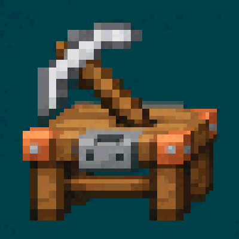
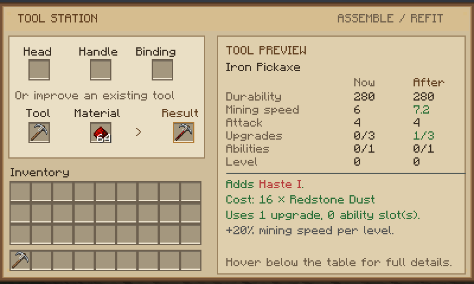

<p align="center"></p>

<h1 align="center">WT Workshop</h1>

<p align="center"><b>Modular tools for Minecraft 1.21.1 (NeoForge)</b><br>
Build tools from parts, melt and cast metals in a Smeltery, and level your tools up with material traits and modifiers.</p>

<p align="center">
<a href="https://www.curseforge.com/minecraft/mc-mods/wt-workshop">CurseForge</a> ·
<a href="https://whotevatech.github.io/wt-workshop/">Website &amp; guide</a> ·
<a href="https://github.com/whotevatech/wt-workshop/releases">Downloads</a> ·
<a href="https://github.com/whotevatech/wt-workshop/issues">Issues</a> ·
<a href="CHANGELOG.md">Changelog</a>
</p>

<p align="center"></p>

## Features

- **Eight tools:** pickaxe, axe, shovel, hoe, sword, hammer (3×3), excavator (3×3) and broad axe (fells trees).
- **13 materials with traits:** wood, stone, flint, bone, bamboo, blaze, copper, iron, gold, rose gold, amethyst bronze, diamond and netherite, plus string, leather, honeycomb and chain bindings.
- **Part Builder:** carves reusable patterns and makes non-metal parts.
- **Smeltery:** melts ores (×2), mixes alloys, and casts metal parts with gold casts. Works with hoppers.
- **Tool Station:** assembles tools, swaps parts, repairs and adds modifiers, showing an exact before/after preview first.
- **Levels:** tools gain XP, levels, upgrade and ability slots, and visible modifier accents. Expansion braces add permanent slots.
- **Integrations:** optional JEI and EMI pages, datapack-driven materials, melting and alloys, and a Java addon API.

Full player guide: **https://whotevatech.github.io/wt-workshop/**

## Downloads

| File | What it is |
|---|---|
| `wt-workshop-0.7.0-beta.1.jar` | The mod. Install on client and server. |
| `wt-beeblock-workshop-0.1.0-beta.1.jar` | Optional [BeeBlock addon](https://whotevatech.github.io/wt-workshop/beeblock.html) (Waxed and Honeybound). Needs WT Workshop 0.7.x. |

Requires Minecraft 1.21.1, NeoForge 21.1.209 or newer, and Java 21. Get them from CurseForge ([WT Workshop](https://www.curseforge.com/minecraft/mc-mods/wt-workshop), [WT BeeBlock Workshop](https://www.curseforge.com/minecraft/mc-mods/wt-beeblock-workshop), where the app installs WT Workshop for the addon automatically) or from GitHub [Releases](https://github.com/whotevatech/wt-workshop/releases).

## Building

```
./gradlew build                                # both jars -> build/libs
./gradlew runGameTestServer                    # automated in-game tests (base)
./gradlew runGameTestServer -PwithBeeAddon     # tests with the addon
./gradlew runClient [-PwithBeeAddon] [-Pviewer=jei|emi|both]
```

Every push runs the build and both test suites on GitHub Actions.

## Repository layout

| Path | Contents |
|---|---|
| `src/main` | The WT Workshop mod. GameTests live in `net/wtworkshop/gametest` and are excluded from the jar. |
| `beeblock-addon/` | The BeeBlock addon, and the worked example for [ADDON-API.md](ADDON-API.md). |
| `tools/`, `art-source/` | The texture and icon pipeline. |
| `docs/` | The website (GitHub Pages), plus older development notes in `docs/dev`. |

## Licence

MIT. See [LICENSE](LICENSE) and [NOTICE-THIRD-PARTY.md](NOTICE-THIRD-PARTY.md). No Minecraft, NeoForge, JEI, EMI, Forestry or FTB binaries are included. Not affiliated with Mojang or Microsoft.
